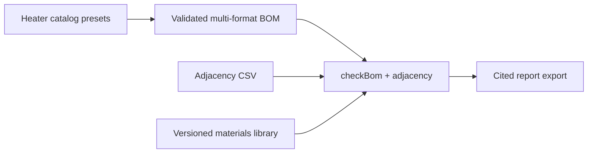

# CAD fire-vulnerability analysis — planning

Status: **pre-prod hardening in progress** (multi-format intake, heaters, adjacency, tests, cited exports).

## Goal

Given a vehicle / habitat / rover CAD-derived parts list, flag fire vulnerabilities that are grounded in cited NASA microgravity and oxygen-compatibility evidence — not a black-box “risk score.”

## Inputs

| Stage | Input | Status |
| --- | --- | --- |
| MVP+ | BOM / build files: JSON, CSV, TSV, NDJSON, XML, glTF materials, STEP name extract | Live on `#cad-checker` |
| MVP+ | Heater/avionics catalog presets (`heaterId`) | Live |
| MVP+ | Adjacency CSV/JSON: `partA,partB,clearanceMm,relation` | Live |
| Later | Full glTF/STEP geometry clearance | Out of current scope |
| Non-goal | Full SolidWorks kernel / proprietary binary parse (`.glb` deferred) | Explicitly out of scope |

## Analysis pipeline

1. **Parse & validate** via `parseBuildFile` (schema v1: material required; zone enum; finite temps).
2. **Normalize materials** via aliases in `src/topics/materials-library.ts`.
3. **Zone rules** — cabin LOI / EVA oxygen-compatibility / propellant-bay caveats.
4. **Temperature degradation** — continuous-use, softening, melt, AIT bands.
5. **Adjacency** — plastics near heat-tagged parts (`near-heat` / `above` / `same-bay`).
6. **Explain & export** — every flag cites library sources; download JSON/CSV report stamped with `MATERIALS_LIBRARY_VERSION`.

## Accepted build file types

- `.json` — array or `{ parts | bom | items | components }`
- `.csv` / `.tsv` — quote-aware headers with aliases
- `.ndjson` / `.jsonl` — one part object per line
- `.xml` — `<part material="…">` attributes or `<Part><Material>` elements
- `.gltf` — materials[].name (and node names as fallback) — temps/zones must be enriched
- `.step` / `.stp` — best-effort MATERIAL/PRODUCT name extraction
- `.glb` — rejected with guidance to export `.gltf` or BOM

## Vulnerability classes

- Habitat O₂ exceeds material LOI band
- Expected temperature enters softening / melt / AIT bands
- Heater-preset temperature fill
- Adjacency near heat / above / same-bay
- Oxygen-wetted incompatible elastomers (e.g. Buna-N)
- Unknown BOM materials
- Nearby fuel flash/AIT within local temperature

## Production-ready exit criteria (pre next sprint)

- [x] Multi-format build intake with clear parse errors
- [x] Deterministic `checkBom` / parse unit tests (`npm test`)
- [x] Heater catalog + adjacency heuristics on `#cad-checker`
- [x] Full cited results export (JSON + CSV) + library version stamp
- [x] Disclaimer: triage aid, not NASA-STD-6001 certification
- [ ] Broader library provenance audit / more CAD commodity materials
- [ ] In-repo Playwright smoke script checked into `scripts/`

## UI surfaces

- **CAD Checker** (`#cad-checker`) — application demo + live checker
- **Viable Materials** — temperature degradation compilation + plan summary
- **Cabin Fire Safety** — evidence synthesis with link into CAD Checker

## Reliable study anchors

- BASS-II solids — https://ntrs.nasa.gov/citations/20210011385
- Textile O₂ flammability chart — https://ntrs.nasa.gov/citations/20170008880
- Enriched-O₂ AIT / pneumatic impact (WSTF) — https://ntrs.nasa.gov/citations/20090001157
- Oxygen compatibility — https://ntrs.nasa.gov/citations/20070016582
- Thermoplastics thermochemistry — https://ntrs.nasa.gov/citations/19780065784
- Saffire-I — https://psi.nasa.gov/physci/repo/data/investigations/PSI-98
- SAME / fire safety overview — https://www.nasa.gov/missions/station/studying-combustion-and-fire-safety/
