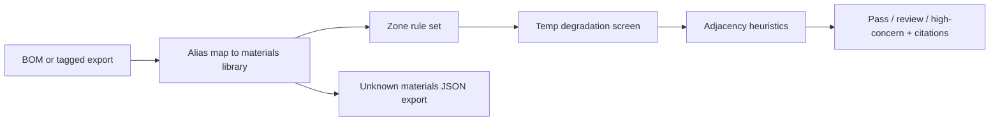

# CAD fire-vulnerability analysis — planning

Status: **started** (library + BOM MVP live; geometry adjacency and CAD-native import planned).

## Goal

Given a vehicle / habitat / rover CAD-derived parts list, flag fire vulnerabilities that are grounded in cited NASA microgravity and oxygen-compatibility evidence — not a black-box “risk score.”

## Inputs (MVP → next)

| Stage | Input | Status |
| --- | --- | --- |
| MVP | BOM CSV/JSON: `material`, optional `mass`/`area`, `nearbyFuel`, `maxExpectedTempC`, `zone` | Live on Cabin Fire Safety |
| Next | Heater/avionics catalog with default surface temperatures | Planned |
| Next | Adjacency table: `partA,partB,clearanceMm` | Planned |
| Later | glTF / STEP material-name tags | Out of day-1 scope |
| Non-goal | Full SolidWorks kernel / proprietary file parse | Explicitly out of scope |

## Analysis pipeline

1. **Normalize materials** via aliases in `src/topics/materials-library.ts`.
2. **Zone rules**
   - `cabin` — LOI vs selected habitat O₂; softening/melt vs `maxExpectedTempC`.
   - `eva-suit` — 100% O₂ / 4.3 psi oxygen-compatibility (impact / adiabatic compression).
   - `propellant-bay` — flash/AIT and leak envelopes; PSI cabin caveats.
3. **Temperature degradation** — compare expected local temperature to continuous-use, softening, melt, decomposition, and autoignition bands in the Viable Materials compilation table.
4. **Adjacency (planned)** — flag high-concern plastics within clearance of heat sources or above melt-drip paths.
5. **Explain** — every flag cites library sources (BASS, textile O₂ chart, WSTF O₂ ignition, oxygen compatibility, thermoplastics NTRS, Saffire/SAME as context).

## Vulnerability classes

- Habitat O₂ exceeds material LOI band
- Expected temperature enters softening / melt / AIT bands
- Melt-drip debris risk (NASA-STD-6001 Test 1 concern)
- Oxygen-wetted incompatible elastomers (e.g. Buna-N)
- Unknown BOM materials
- Nearby fuel flash/AIT within local temperature
- Detection gap heuristic (optional): heat source with no SAME-informed sensor note in compact volumes

## Reliable study anchors

- BASS-II solids — https://ntrs.nasa.gov/citations/20210011385
- Textile O₂ flammability chart — https://ntrs.nasa.gov/citations/20170008880
- Enriched-O₂ AIT / pneumatic impact (WSTF) — https://ntrs.nasa.gov/citations/20090001157
- Oxygen compatibility — https://ntrs.nasa.gov/citations/20070016582
- Thermoplastics thermochemistry — https://ntrs.nasa.gov/citations/19780065784
- Saffire-I — https://psi.nasa.gov/physci/repo/data/investigations/PSI-98
- SAME / fire safety overview — https://www.nasa.gov/missions/station/studying-combustion-and-fire-safety/

## UI surfaces

- **Viable Materials** — temperature degradation & flammability compilation + this plan summary
- **Cabin Fire Safety** — runnable BOM checker + unknown-material session export

## Success criteria for the next increment

- [ ] Heater catalog presets populate `maxExpectedTempC` for common avionics zones
- [ ] Adjacency CSV produces at least one “plastic near heater” flag using library temps
- [ ] Unknown export remains the feedback loop into `materials-library.ts`
- [ ] No uncited numeric claims in SI summaries
