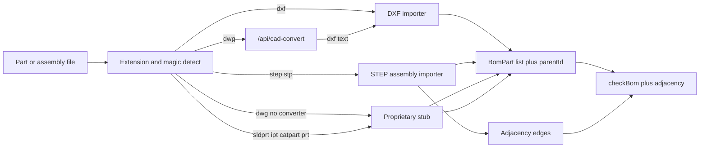

# Native CAD parts analysis — assembly plan

Status: **Phase 2 shipping** (DXF live; DWG convert worker; STEP assembly hub + fixtures).

## Goal

Accept real engineering part/assembly files and produce the same materials-tagged BOM the CAD Checker already ranks — without claiming a full SolidWorks/CATIA kernel in the browser.

## Format matrix

| Format | Vendor | Browser-native today | Near-term path | Later / licensed |
| --- | --- | --- | --- | --- |
| `.dxf` | AutoCAD exchange | **Yes** — ASCII layer/block/text extract | Enrich with `MATERIAL` attributes | — |
| `.dwg` | AutoCAD | **Phase 1** — fixture unwrap + `/api/cad-convert`; real DWG via upstream | Wire `CAD_CONVERT_UPSTREAM` (ODA / LibreDWG service) | ODA Drawings SDK |
| `.step` / `.stp` | Interchange hub | **Phase 2** — PRODUCT + NAUO → parts + `parentId` + adjacency | Richer AP214 graphs / PMI materials | — |
| `.sldprt` / `.sldasm` | SOLIDWORKS | Detect + filename stem fallback | Export STEP/glTF/BOM from SW (fixture included) | Full SW API assembly tree |
| `.ipt` / `.iam` | Inventor | Detect + stem fallback | Inventor Server / AnyCAD → STEP; or BOM export | Autodesk Platform Services |
| `.catpart` / `.catproduct` | CATIA | Detect + stem fallback | 3DEXPERIENCE / CATIA batch → STEP | Dassault APIs |
| `.prt` / `.asm` | NX or Creo | Detect + stem fallback (ambiguous) | NX Open / Creo TOOLKIT → STEP; require vendor hint in UI | Licensed toolkits |

**Non-goal:** pixel-perfect geometry, mates, or mass properties from proprietary binaries in pure client JS. **Never invent materials** — converters only emit interchange text (DXF/STEP/BOM); ranking still comes from the curated library.

## Architecture

Code layout:

- `src/topics/cad-checker/importers/` — DXF, STEP assembly, proprietary stubs, convert client, registry
- `api/cad-convert.ts` + `api/lib/cad-convert-core.ts` — Phase 1 DWG worker
- `parse-bom.ts` — BOM/CSV/JSON/glTF + STEP via assembly importer
- `mount.ts` — routes uploads through `importCadUpload()`; auto-fills adjacency from STEP trees

## Phased delivery

### Phase 0 — done

- Importer registry for proprietary extensions
- **DXF** material/layer/block name → `BomPart[]`
- Proprietary formats: conversion guidance + filename-stem candidate
- Sample DXF guided demo

### Phase 1 — done (structure)

- `POST /api/cad-convert`, fixture DWG unwrap, client wiring
- Remaining: real `CAD_CONVERT_UPSTREAM`, rate limits

### Phase 2 — assembly trees (this change)

**Shipped:**

1. **STEP assembly importer** (`importers/step-assembly.ts`)
   - `PRODUCT` entities → `BomPart` with stable ids
   - `NEXT_ASSEMBLY_USAGE_OCCURRENCE` + optional `/* FLAME_TREE … */` → `parentId`
   - Inferred adjacency (`same-bay` / `near-heat`) auto-loaded into the checker
2. **Flame BOM JSON** with `parentId` also infers adjacency
3. **Fixtures**
   - `public/samples/sample-sw-habitat-assy.step` (SolidWorks→STEP stand-in)
   - `public/samples/sample-sw-habitat-assy.bom.json`
4. **Guided demo** — STEP assembly card (no download)

**Also in this PR (integration follow-through):**

- Imported-parts **assembly tree preview** in CAD Checker (structure visibility; not a geometry kernel)
- AP214-style `PRODUCT_DEFINITION` / `PRODUCT_DEFINITION_FORMATION` fixture + NAUO resolution
- `/api/cad-convert` in-memory rate limit (`CAD_CONVERT_RATE_MAX`)

**Still open:**

- [ ] Real vendor STEP dumps for broader AP214 coverage
- [ ] Optional glTF mesh viewer (Future UX — 3D, beyond the tree preview)

### Phase 3 — licensed deep integrations

- SOLIDWORKS PDM/Document Manager or desktop add-in exporting Flame BOM JSON
- Inventor/CATIA/NX/Creo batch exporters writing the same schema (`material`, `zone`, `heaterId`, `parentId`, …)

## Future UX (explicit backlog — not this PR)

Keep start-page work separate. Later CAD-only UI pass:

1. **CAD Checker visual chrome** — clearer hierarchy for demos / atmosphere / live results; less developer-tool density while staying tool-first.
2. **Part preview when you add a file** — ~~structured tree of PRODUCT/`parentId` nodes~~ (shipped as CAD Checker import preview). Still open: glTF/mesh viewer when CAD provides geometry. Materials-tagged BOM remains the analysis source of truth; preview must not invent flammability data.

## Demo promise (no download)

- Guided **DXF acrylic panel** demo
- Guided **STEP habitat assembly** demo (PRODUCT/NAUO → adjacency)
- Fixture DWG sample for Phase 1 convert round-trip

## Success criteria

- [x] DXF upload produces ≥1 library-matched or unknown part rows
- [x] Each proprietary extension is recognized with an actionable conversion message
- [x] DWG fixture round-trips through convert→DXF in unit tests
- [x] STEP assembly produces parts with `parentId` and inferred adjacency
- [x] SolidWorks→STEP (stand-in) + Flame BOM fixtures in `public/samples/`
- [ ] Real DWG round-trips via configured upstream in staging
- [x] Imported-parts assembly tree preview in CAD Checker
- [ ] glTF/mesh part viewer (Future UX)
