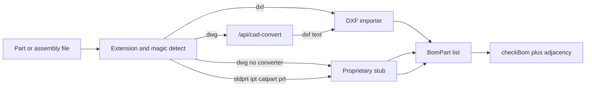

# Native CAD parts analysis — assembly plan

Status: **Phase 1 in progress** (DXF live; DWG→DXF worker scaffolded; proprietary detect + guidance).

## Goal

Accept real engineering part/assembly files and produce the same materials-tagged BOM the CAD Checker already ranks — without claiming a full SolidWorks/CATIA kernel in the browser.

## Format matrix

| Format | Vendor | Browser-native today | Near-term path | Later / licensed |
| --- | --- | --- | --- | --- |
| `.dxf` | AutoCAD exchange | **Yes** — ASCII layer/block/text extract | Enrich with `MATERIAL` attributes | — |
| `.dwg` | AutoCAD | **Phase 1** — fixture unwrap + `/api/cad-convert`; real DWG via upstream | Wire `CAD_CONVERT_UPSTREAM` (ODA / LibreDWG service) | ODA Drawings SDK |
| `.sldprt` / `.sldasm` | SOLIDWORKS | Detect + filename stem fallback | Export STEP/glTF/BOM from SW; or SW Document Manager / API on a worker | Full SW API assembly tree |
| `.ipt` / `.iam` | Inventor | Detect + stem fallback | Inventor Server / AnyCAD → STEP; or BOM export | Autodesk Platform Services |
| `.catpart` / `.catproduct` | CATIA | Detect + stem fallback | 3DEXPERIENCE / CATIA batch → STEP | Dassault APIs |
| `.prt` / `.asm` | NX or Creo | Detect + stem fallback (ambiguous) | NX Open / Creo TOOLKIT → STEP; require vendor hint in UI | Licensed toolkits |

**Non-goal:** pixel-perfect geometry, mates, or mass properties from proprietary binaries in pure client JS. **Never invent materials** — converters only emit interchange text (DXF/STEP/BOM); ranking still comes from the curated library.

## Architecture

Code layout:

- `src/topics/cad-checker/importers/` — DXF, proprietary stubs, convert client, registry
- `api/cad-convert.ts` + `api/lib/cad-convert-core.ts` — Phase 1 worker
- `parse-bom.ts` — BOM/CSV/JSON/glTF/STEP text paths
- `mount.ts` — routes uploads through `importCadUpload()` before `checkBom`

## Phased delivery

### Phase 0 — done

- Importer registry for the listed extensions
- **DXF** material/layer/block name → `BomPart[]`
- Proprietary formats: conversion guidance + filename-stem candidate
- Sample DXF guided demo (no download required)

### Phase 1 — DWG→DXF conversion worker (this change)

**Shipped structure:**

1. **`POST /api/cad-convert`** — JSON `{ fileName, contentBase64 }`
   - Size limit: 3 MiB raw
   - Optional `CAD_CONVERT_TOKEN` (Bearer) when set
   - Strategies: DXF passthrough → Flame **fixture DWG** unwrap → optional **`CAD_CONVERT_UPSTREAM`**
   - Returns DXF text only (no invented materials)
2. **Client** — DWG upload tries fixture unwrap (works offline), then API, then proprietary fallback
3. **CI fixture** — `public/samples/sample-habitat-cover.fixture.dwg` (`AC1032` + `FLAME_DXF_V1\n` + ASCII DXF)
4. **Env** — see `.env.example` (`CAD_CONVERT_TOKEN`, `CAD_CONVERT_UPSTREAM`, `CAD_CONVERT_UPSTREAM_TOKEN`)

**Still open for Phase 1 close-out:**

- [ ] Point `CAD_CONVERT_UPSTREAM` at a real ODA/LibreDWG container in staging
- [ ] Rate limiting / abuse controls on the public convert route
- [ ] Optional guided demo card that loads the fixture DWG (fixture unwrap already works without download of proprietary kernels)

### Phase 2 — assembly trees

- Prefer **STEP** as the interchange hub (PRODUCT/MATERIAL names already extracted)
- Map assembly instance names → parts with `id` + parent hints for adjacency
- Optional: glTF from CAD for visual preview (materials only until geometry adjacency returns)
- Add at least one SolidWorks→STEP (or Flame BOM) fixture under `public/samples/`

### Phase 3 — licensed deep integrations

- SOLIDWORKS PDM/Document Manager or desktop add-in exporting Flame BOM JSON
- Inventor/CATIA/NX/Creo batch exporters writing the same schema (`material`, `zone`, `heaterId`, …)

## Demo promise (no download)

- Guided **DXF acrylic panel** demo — in-repo ASCII DXF → flammability table
- **Fixture DWG** sample — same DXF payload wrapped for convert round-trip tests / upload

## Success criteria

- [x] DXF upload produces ≥1 library-matched or unknown part rows
- [x] Each proprietary extension is recognized with an actionable conversion message
- [x] DWG fixture round-trips through convert→DXF in unit tests
- [ ] Real DWG round-trips via configured upstream in staging
- [ ] At least one SolidWorks→STEP (or Flame BOM) fixture in `public/samples/`
