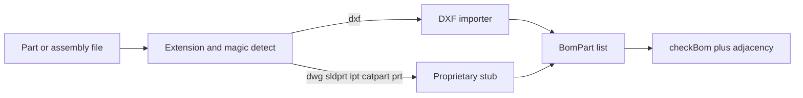

# Native CAD parts analysis — assembly plan

Status: **structure started** (DXF live; proprietary formats detected with conversion path).

## Goal

Accept real engineering part/assembly files and produce the same materials-tagged BOM the CAD Checker already ranks — without claiming a full SolidWorks/CATIA kernel in the browser.

## Format matrix

| Format | Vendor | Browser-native today | Near-term path | Later / licensed |
| --- | --- | --- | --- | --- |
| `.dxf` | AutoCAD exchange | **Yes** — ASCII layer/block/text extract | Enrich with `MATERIAL` attributes | — |
| `.dwg` | AutoCAD | Detect only | Server convert DWG→DXF (ODA / LibreDWG / cloud converter) then reuse DXF importer | ODA Drawings SDK |
| `.sldprt` / `.sldasm` | SOLIDWORKS | Detect + filename stem fallback | Export STEP/glTF/BOM from SW; or SW Document Manager / API on a worker | Full SW API assembly tree |
| `.ipt` / `.iam` | Inventor | Detect + stem fallback | Inventor Server / AnyCAD → STEP; or BOM export | Autodesk Platform Services |
| `.catpart` / `.catproduct` | CATIA | Detect + stem fallback | 3DEXPERIENCE / CATIA batch → STEP | Dassault APIs |
| `.prt` / `.asm` | NX or Creo | Detect + stem fallback (ambiguous) | NX Open / Creo TOOLKIT → STEP; require vendor hint in UI | Licensed toolkits |

**Non-goal (this sprint):** pixel-perfect geometry, mates, or mass properties from proprietary binaries in pure client JS.

## Architecture (assembled now)

Code layout:

- `src/topics/cad-checker/importers/` — one module per family + `registry.ts`
- `parse-bom.ts` — continues to own BOM/CSV/JSON/glTF/STEP text paths
- `mount.ts` — routes uploads through `importCadUpload()` before `checkBom`

Each importer returns `{ format, parts, issues, conversion?: { needed, recommend } }`.

## Phased delivery

### Phase 0 — done in this change

- Importer registry for the listed extensions
- **DXF** material/layer/block name → `BomPart[]`
- Proprietary formats: clear warnings + recommended export (STEP/DXF/BOM) + optional filename-stem candidate
- Sample DXF guided demo (no download required)
- Plan doc (this file)

### Phase 1 — conversion worker (next sprint)

- Vercel/Node route `POST /api/cad-convert` accepting DWG (and later others)
- Prefer open path: DWG→DXF via a containerized converter, then client DXF importer
- Auth + size limits; never invent materials

### Phase 2 — assembly trees

- STEP already extracts PRODUCT/MATERIAL names — prefer STEP as the interchange hub
- Map assembly instance names → parts with `id` + parent hints for adjacency
- Optional: glTF from CAD for visual preview (materials only until geometry adjacency returns)

### Phase 3 — licensed deep integrations

- SOLIDWORKS PDM/Document Manager or desktop add-in exporting Flame BOM JSON
- Inventor/CATIA/NX/Creo batch exporters writing the same schema (`material`, `zone`, `heaterId`, …)

## Demo promise (no download)

Guided **DXF acrylic panel** demo loads an in-repo ASCII DXF, extracts layers/materials, and auto-runs the flammability table in-page — same as the BOM guided demos.

## Success criteria

- [x] DXF upload produces ≥1 library-matched or unknown part rows
- [x] Each proprietary extension is recognized with an actionable conversion message
- [ ] DWG round-trips through convert→DXF in CI
- [ ] At least one SolidWorks→STEP (or Flame BOM) fixture in `public/samples/`
